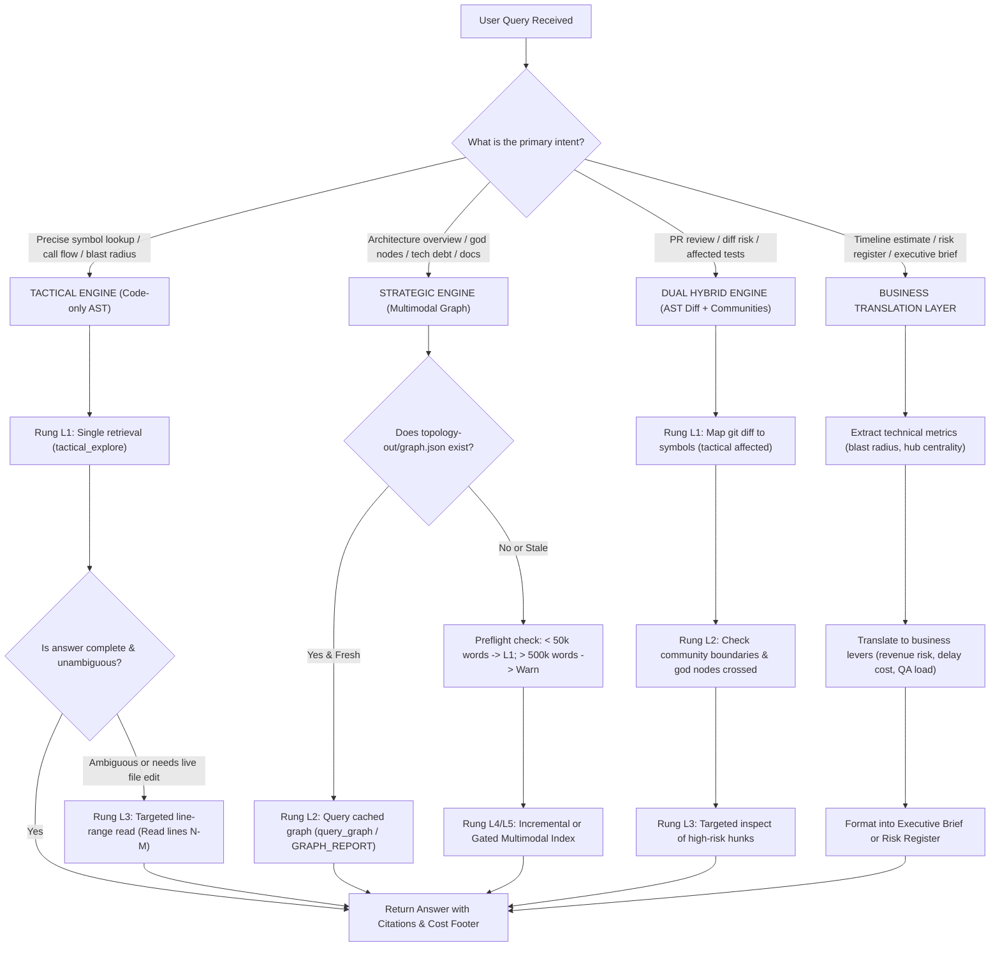

# Mode Router & Decision Tree

This reference provides the intent-classification engine for ultima-graph. Load this file whenever routing a user query to determine the primary engine (Tactical vs. Strategic vs. Business Synthesis), execution depth, and escalation triggers.

---

## 1. Architectural Routing Decision Tree

---

## 2. Intent Classification Matrix

| Category | Typical Phrasing Indicators | Primary Engine | Initial Rung | Escalation Trigger |
|---|---|---|---|---|
| **Code Lookup & Flow** | "Where is X", "How does X work", "Trace flow from A to B", "What calls X" | Tactical Engine | L1 (`tactical_explore`) | Escalate to L3 if symbol overload is ambiguous or line numbers shifted. |
| **Blast Radius & Impact** | "What breaks if I change X", "Who uses this method", "Impact radius of X" | Tactical Engine | L1 (`tactical impact`) | Escalate to L2 if impact crosses into unknown architectural modules. |
| **Selective Testing** | "Which tests should I run", "Affected test specs for this diff", "Minimal CI suite" | Tactical Engine | L1 (`tactical affected --stdin`) | Escalate to L3 to map route URLs to Playwright E2E spec files. |
| **Dead Code & Cleanup** | "Find unused code", "Dead functions", "Can I safely delete X", "Circular imports" | Tactical Engine | L1 (`tactical dead-code` / `cycles`) | Escalate to L2 to confirm documentation doesn't reference candidate. |
| **System Onboarding** | "Onboard me", "Map this repo", "Explain system architecture", "Show me main modules" | Strategic Engine | L2 (`GRAPH_REPORT.md` / `cluster`) | Escalate to L1 to inspect specific interface implementations. |
| **Tech Debt & Hotspots** | "Architecture audit", "God nodes", "Monolith hotspots", "Spaghetti dependencies" | Strategic Engine | L2 (`god_nodes` / `surprising_connections`) | Escalate to L1 to calculate recursive blast radius on top 3 hubs. |
| **Documentation Drift** | "Does README match code", "Audit API docs against endpoints", "Docs drift" | Strategic Engine | L5 (Selective Doc Extraction) | Escalate to L3 to verify extracted code routes against doc claims. |
| **Pull Request Triage** | "Review this PR", "Risk assessment on diff", "Triage open PRs" | Dual Engine | L1 (Diff Map) + L2 (Clusters) | Escalate to L3 for manual review of high-centrality method changes. |
| **Stakeholder Estimation** | "Estimate this feature", "Executive brief", "Risk of rewriting module", "Client quote" | Business Layer | L1/L2 Technical Metrics | Escalate to L1 if scope boundaries are unverified. |

---

## 3. Worked Routing Examples (12 Scenarios)

### Example 1: Precision Flow Query
* **User Input:** "How does an incoming HTTP request reach the database query in our billing service?"
* **Classification:** Code Lookup & Flow.
* **Routing:** Tactical Engine (`tactical_explore "BillingController processPayment queryDatabase"`).
* **Execution Rung:** L1.
* **Escalation:** None. Returns verbatim source, call path, and callee list in one round-trip.

### Example 2: Change Impact Query
* **User Input:** "I need to rename `UserProfile.updateEmail`. What could break?"
* **Classification:** Blast Radius & Impact.
* **Routing:** Tactical Engine (`tactical impact UserProfile.updateEmail`).
* **Execution Rung:** L1.
* **Escalation:** If inbound callers exceed 10, escalate to L2 to check whether callers reside in multiple communities.

### Example 3: Vague Technical Sentiment
* **User Input:** "This orders module feels slow and fragile to change. What is wrong with it?"
* **Classification:** Tech Debt & Hotspots.
* **Routing:** Strategic Engine (`strategic` community analytics).
* **Execution Rung:** L2 (Examine community cohesion score and check if `OrderService` is ranked as a God Node).
* **Escalation:** L1 on the central hub symbol to identify circular caller loops.

### Example 4: Emotional Fear Query
* **User Input:** "What are we most afraid to touch in this codebase?"
* **Classification:** Tech Debt & Single Points of Failure.
* **Routing:** Strategic Engine (`god_nodes` + `surprising_connections`).
* **Execution Rung:** L2.
* **Escalation:** Translate top 3 highest-degree nodes into business single-points-of-failure using the Business Lens.

### Example 5: New Engineer Onboarding
* **User Input:** "I just cloned this project. Give me a clean high-level tour before I write code."
* **Classification:** System Onboarding.
* **Routing:** Strategic Engine (`topology-out/GRAPH_REPORT.md` + Leiden community breakdown).
* **Execution Rung:** L2.
* **Escalation:** Do not run L5 multimodal extraction unless user explicitly requests document/media ingestion.

### Example 6: Fast Pre-Commit Test Selection
* **User Input:** "I just modified `auth_middleware.py`. Which tests do I need to run before pushing?"
* **Classification:** Selective Testing.
* **Routing:** Tactical Engine (`tactical affected src/auth_middleware.py`).
* **Execution Rung:** L1.
* **Escalation:** L3: Map any modified web routes to corresponding E2E Playwright test specs.

### Example 7: Documentation Integrity Audit
* **User Input:** "Check our `/docs` folder against the actual codebase. Are our setup and API docs lying to us?"
* **Classification:** Documentation Drift.
* **Routing:** Strategic Engine (Hybrid AST + Document Extraction).
* **Execution Rung:** L5 (Run preflight estimate first; extract only changed Markdown files).
* **Escalation:** L1 to verify whether documented function signatures match the live database.

### Example 8: Monorepo Cross-Service Call
* **User Input:** "Does our web frontend call the inventory microservice directly or through the gateway?"
* **Classification:** Cross-Tier Flow.
* **Routing:** Tactical Engine (`tactical_explore "inventoryClient apiGateway fetchInventory"`).
* **Execution Rung:** L1 (Relying on cross-tier `tier-synthesizer` connecting client fetch paths to route handlers).
* **Escalation:** None.

### Example 9: Pull Request Risk Scoring
* **User Input:** "Here is git diff `origin/main...feature-checkout`. Assess risk and tell me what to focus on."
* **Classification:** PR Triage.
* **Routing:** Dual Engine. Tactical engine maps modified lines to symbols; Strategic engine maps symbols to community clusters.
* **Execution Rung:** L1 + L2.
* **Escalation:** L3 on specific hunks modifying high-centrality symbols.

### Example 10: Client Timeline & Budget Estimation
* **User Input:** "A client wants to replace our existing authentication with Auth0. Estimate complexity and risks."
* **Classification:** Stakeholder Estimation.
* **Routing:** Tactical Engine (impact radius on auth symbols) -> Business Translation Layer.
* **Execution Rung:** L1 -> Business Lens.
* **Escalation:** Formulate low/high range estimates based on count of affected callers and affected test suites.

### Example 11: Dead Code Elimination
* **User Input:** "We suspect half of `legacy_reports.ts` is unused. Can we purge it?"
* **Classification:** Dead Code.
* **Routing:** Tactical Engine (`tactical dead-code legacy_reports.ts`).
* **Execution Rung:** L1.
* **Escalation:** L2 to verify that external documentation or non-code configs do not reference the exported names.

### Example 12: Broken Index / Stale State Handling
* **User Input:** "Find where we process Stripe webhooks. Note: I just pulled new code."
* **Classification:** Code Lookup with Stale Index Risk.
* **Routing:** Tactical Engine (`tactical sync` then `tactical_explore "stripeWebhook handleEvent"`).
* **Execution Rung:** L4 (Incremental Sync) -> L1.
* **Escalation:** If tactical engine is not installed, route to Graceful Degradation (tight lexical grep + targeted range reads).
